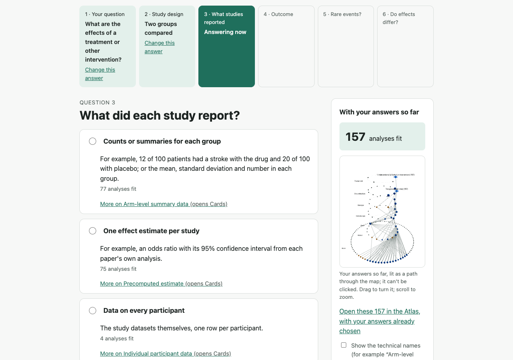
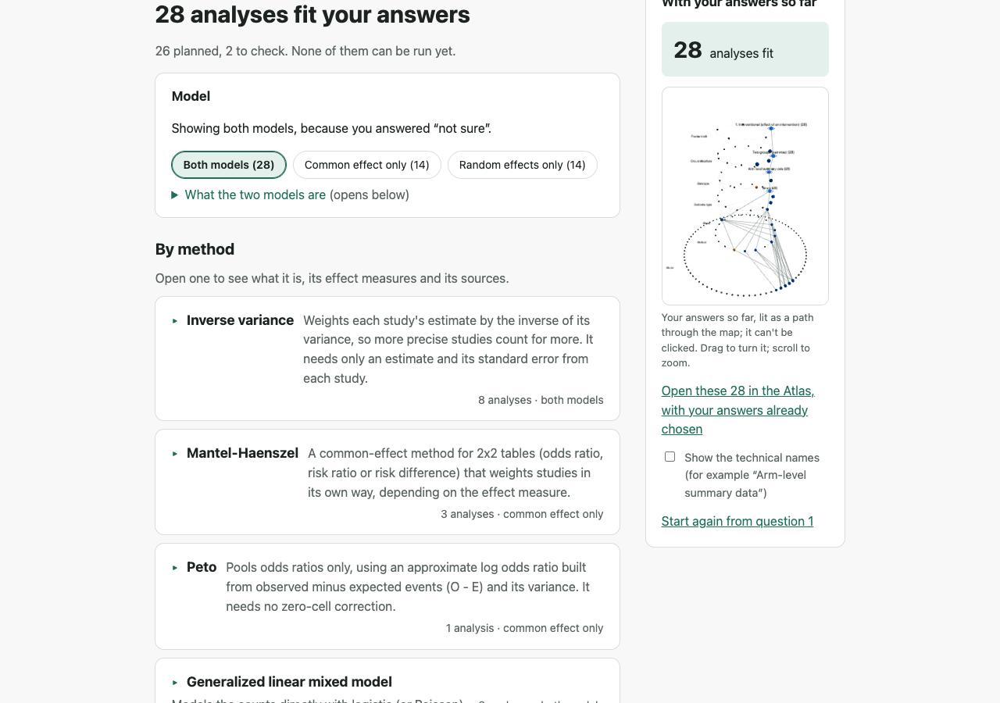
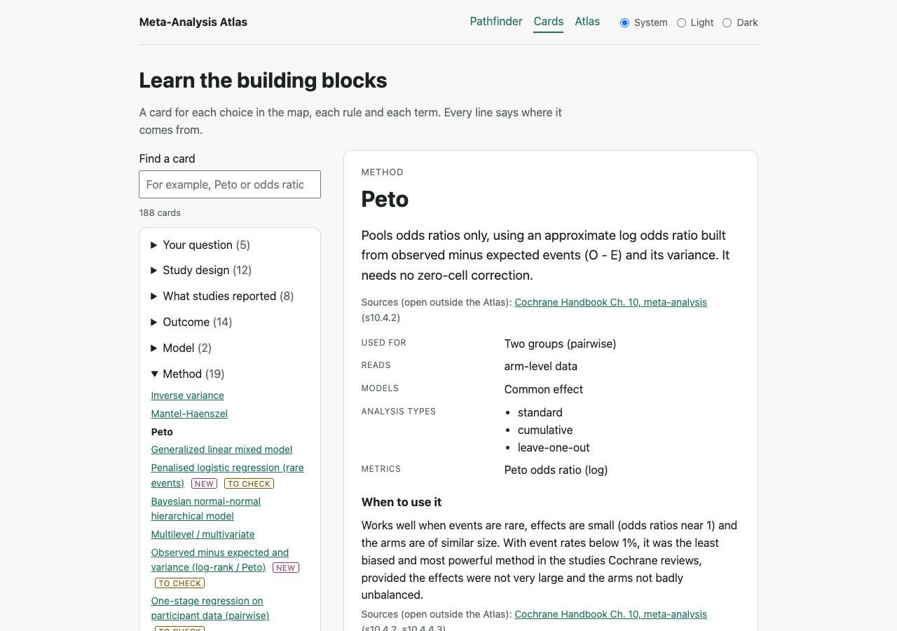
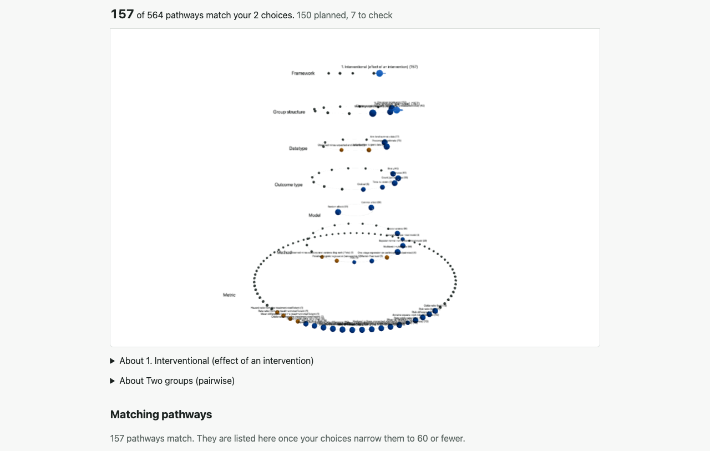
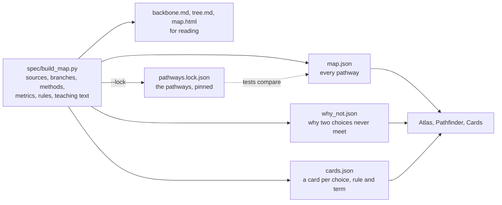

# Meta-Analysis Atlas

A map of meta-analysis: every valid route from a research question to a
pooled result, in the order a methodologist asks the questions.

```
Framework → Group structure → Datatype → Outcome type → Model → Method → Metric
```

The map covers five frameworks (interventional, including network
meta-analysis; diagnostic test accuracy; prognosis; association; measurement
reliability) and 540 pathways. Every entry cites its source: the Cochrane
Handbook, the documentation of the R package that runs it, or a methods paper
or textbook. Entries that haven't been confirmed against a primary source
are marked as such.

## Status

Version 0.1 is the map and three apps for exploring it. **Nothing runs
analyses yet.** Each pathway has a status:

| Status | Pathways | Meaning |
|---|---|---|
| Planned | 430 | Confirmed from its sources; its engine is on the roadmap |
| Specified | 79 | Confirmed from its sources; not planned yet |
| To check | 31 | Not yet confirmed from a primary source |
| Runnable | 0 | Passes a validation test against a published worked example or the R package itself; none yet |

A pathway becomes runnable only when it passes a validation test, against a
published worked example or the R package run on the same data
([how statuses are set](docs/decisions/0001-pathway-status.md)).

## The apps

**Pathfinder** asks up to six questions, one at a time, in a methodologist's
order: the kind of question, what each study compares, what it reported, and
the outcome. Each option is named in plain words, with an example and its
source; a switch shows the technical names. Options the map rules out say
why. For binary outcomes from arm-level counts, compared between two groups or
across a network, it asks whether events are rare, and when both models fit
it asks whether true effects are expected to differ. Neither answer removes a
pathway ([why](docs/decisions/0005-pathfinder-advisory-questions.md)). The
side panel shows the answers so far as a path on a small, read-only 3D map.



The results come answer first: how many analyses fit, then the advice the
answers asked for, then the analyses grouped by method. Each method opens to
what its card says, its effect measures, its status and its sources.



**Cards** gives every choice, rule and glossary term a card. A choice's card
says what it is, then when to use it and its cautions, each line with its
source, then the R call, the rules behind its limits (each in plain words) and
the terms it uses, which open on the card. A choice's card has no teaching
text where no source that covers it has been read yet. A glossary of 14 terms is
linked from the cards that use them.



**Atlas** shows every pathway as a 3D map: one layer per tier, with lines
joining the nodes that go together. Drag to turn it, scroll to zoom; the
arrow keys and + and - work too. Clicking a node keeps only the pathways
through it, and again undoes it. A grey node says why it doesn't fit, citing
the rule or source behind it where there is one. Beside the map, a read-only
panel shows what was clicked and the options at the next step. A text view
lists the same nodes and counts for screen readers and the keyboard, and is
used where 3D can't be drawn.



## How the map is built

The map is the specification. All of its data is in one file,
[`spec/build_map.py`](spec/build_map.py), and everything else is generated
from it. Pathways aren't listed by hand: the generator combines the branches,
methods and metrics and keeps the combinations the rules allow.



To read the map without the apps:

- [`spec/tree.md`](spec/tree.md): the full tree as text.
- [`spec/backbone.md`](spec/backbone.md): the metrics, methods and rules,
  each with its source.
- `spec/map.html`: a searchable page; download it and open it in a browser.

## Run the apps locally

With Node 22 or later:

```bash
npm ci --prefix frontend
npm --prefix frontend run dev    # then open http://localhost:5173
```

The apps read the map from `spec/` when they are built.

## Add or change a pathway

1. Open an issue that says what should change and why, with a source: a
   Cochrane Handbook section, the documentation of the R function, or a
   methods paper.
2. On a branch named `feat/<issue>-<slug>`, edit the data in
   `spec/build_map.py`: a branch, a method (with its R function, the models
   it fits and the data it reads), a metric (with its exact call, such as
   `escalc(measure="SMD")`) or a rule. Give every entry its source. Mark an
   entry not yet confirmed from a primary source `verified=False`, and one
   that isn't in the reviewed draft the map started from `added=True`.
3. Run `python3 spec/build_map.py --lock`. The diff of
   `spec/pathways.lock.json` lists every pathway added or removed. Then run
   `scripts/check.sh`; every check must pass.
4. Open a pull request for the map change alone that explains each change in
   that diff, with its reference. A methodology decision also gets a short
   record in [`docs/decisions/`](docs/decisions/).

Every change to the map is audited against its sources before review.

## Propose a methodology change

Open an issue. Say what the map gets wrong or leaves out, and cite the source
that shows it, by section. Where methodologists disagree, the map presents the
question as debate, so an issue that sets out both sides is welcome.

## How this project is run

Every change starts as an issue and lands through a reviewed pull request,
including changes to the methodology. The rules are in
[`CLAUDE.md`](CLAUDE.md), and the changes are listed in
[`CHANGELOG.md`](CHANGELOG.md).

## Roadmap

| Release | Scope |
|---|---|
| v0.1 | The map with all five frameworks; Atlas (3D, with a text view), Pathfinder and Cards |
| v0.2 | Running analyses on your own data or on published examples, with the exact R code shown; one-group and two-group metafor pathways made runnable through validation tests |
| v0.3 | Network meta-analysis, Bayesian and multilevel models |
| v0.4 | Diagnostic accuracy, prognosis, and a methods advisor |

## License

GPL-3.0-or-later. See [`LICENSE`](LICENSE) and [`NOTICE`](NOTICE).
